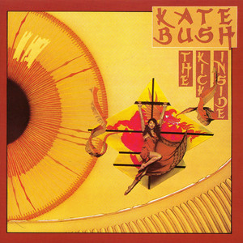
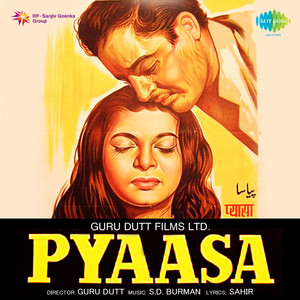
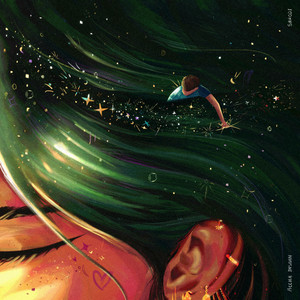
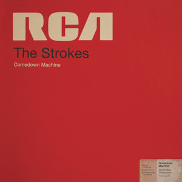

 

 ### i'm just a curious cat :p

<h2 align="center">my current music obsession :D</h2>

<table>
<tr>
<td align="center">
<a href="https://open.spotify.com/track/628RVPULYzx6bvh8uf0Msn?si=98297e4fa6954370">
 
<b>Oh to Be in Love</b> 
Kate Bush
</a>
</td>

<td align="center">
<a href="https://open.spotify.com/track/4lKHw9LqWelunwEvUDukF0?si=f69b996df91e43a0">
 
<b>Jaane wo kaise log the</b> 
Hemant Kumar
</a>
</td>

<td align="center">
<a href="https://open.spotify.com/track/3bgQz4ZRYjjzdvdxaIoLQj?si=e74ccb3c2bd04e5f">
 
<b>chehra tera</b> 
Accha Insaan, sarodi
</a>
</td>

<td align="center">
<a href="https://open.spotify.com/track/3Y4rUyw7XBCK6hGHCOt6rp?si=d184a9511027475e">
 
<b>Call It Fate, Call It Karma</b> 
The Strokes
</a>
</td>
</tr>
</table>
